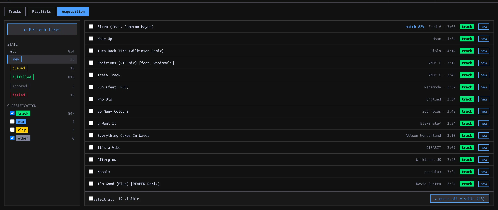

## Prepare the sources {#prepare}

Connect **SoundCloud** and/or **Spotify** in **Settings → Accounts** (or their Setup guides). A connected account reveals **SYNC → Acquisition**; connection alone does **not** refresh likes. manaDJ does not download audio: Acquisition is a wishlist, and each wanted item links out to a Beatport search so you can buy a legitimate copy. For account connection steps, see [first run](../start/index.html#accounts).

## Review your likes {#review}

1. Open **SYNC → Acquisition** and click **↻ Refresh likes**. Check the reported new and total local counts. The refresh adds unseen SoundCloud likes, classifies them and looks for Library matches. Unliking on SoundCloud does not delete an item already recorded in manaDJ. Spotify Liked Songs and playlists are browse-only: **+ want** turns a row into a Source Item.
2. Start with the **new** state list. The default classification filter shows **track** and **other**; check **mix** or **clip** to reveal those suspected classifications. Click a row’s classification chip to cycle **track → mix → clip → other** if it was misclassified. Classification filters visibility; it does **not** mark an item ignored.
3. Click an item to inspect the detail panel. Compare a proposed SoundCloud↔Library match before choosing **accept match** or **reject**. An accepted match fulfills the Source Item — the Track is already accounted for. For a match the scanner missed, use **manual link**, search by title, artist or filename, and pick the correct Library Track. Optionally record **audio from** (a URL or label such as `cd-rip`) as asserted provenance.

| State/filter | Meaning / next action |
| --- | --- |
| **new** | Not fulfilled; check for a proposed match, link manually, open **find on Beatport ↗**, or **ignore**. |
| **fulfilled** | Linked to a Library Track, either from an existing match or because you got the audio. Check provenance before assuming where it came from. |
| **ignored** | Removed from the active worklist; **restore** reverses the decision. |

## Get missing audio {#get}

1. In a new unmatched item, choose **find on Beatport ↗** to open a Beatport search for the track (built from the cleaned-up artist and title, so junk tokens don't poison the query). Buy or otherwise obtain the audio yourself.
2. Drop the file into your tracks directory; the next Scan imports it as a Track. manaDJ's matcher usually links it to the wishlist item on its own — accept the proposed match, or use **manual link**.
3. Check the Track in the Library. Verify metadata, Tags and Energy; fulfillment does not mean curation is complete. See [curation](../curate/index.html#edit-track).

Provenance for audio manaDJ never downloaded is asserted by you or derived from file hints at import (purchase tag URLs, yt-dlp IDs); you can always update an assertion.